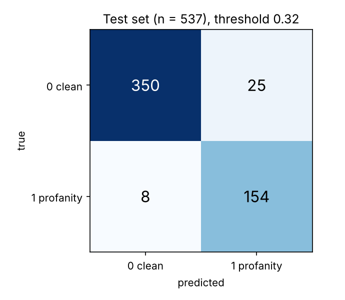

# Kazakh Profanity Detection in Product Reviews and Comments

**Author:** Baigazy Iliyas · **Student ID:** 25MD0217 · DSSC5113 Bonus Project (Fall 2026)

A binary text classifier: given **one Kazakh comment or product review**, it predicts

* **0** — no Kazakh profanity,
* **1** — Kazakh profanity present,

and shows the model's probability `P(profanity)`.
Model: **character n-gram TF-IDF + logistic regression**, trained from scratch on ~3.7k labelled comments.

| Test set (n = 537) | Precision (class 1) | Recall (class 1) | F1 (class 1) |
|---|---|---|---|
| threshold 0.32 (chosen on validation) | **0.860** | **0.951** | **0.903** |

---

## Quick start

### Google Colab (no local setup)
Open `notebooks/Kazakh_Profanity_Colab.ipynb` in Colab (File → Open notebook → GitHub, paste this repository's URL) and run all cells. It clones the repository, installs the pinned packages, loads the saved model, lets you type your own comment, and can rebuild the data and retrain from scratch.

### Local
```bash
git clone https://github.com/<your-github-username>/kazakh-profanity-detection.git
cd kazakh-profanity-detection
python -m venv .venv && source .venv/bin/activate      # Windows: .venv\Scripts\activate
pip install -r requirements.txt

# predict with the saved model (no retraining)
python src/predict.py "Тауар сапасы өте нашар, ақшама өкіндім"
python src/predict.py                                   # interactive: type comments, empty line to quit
```
From Python:
```python
from src.predict import load, predict
model, thr = load()
predict(["Сапасы керемет, рахмет!", "Шешеңнің амы, тартылмайды"], model, thr)
# [{'text': ..., 'label': 0, 'prob_profanity': 0.001}, {'text': ..., 'label': 1, 'prob_profanity': 0.988}]
```

### Reproduce everything
```bash
python src/prepare_data.py   # build dataset + split (downloads KazSAnDRA zips from GitHub, ~10 MB)
python src/train.py          # grid search + threshold on VALIDATION, saves models/
python src/evaluate.py       # one evaluation on TEST, writes results/
```
Runs in under a minute on a CPU. All randomness uses `seed = 42` (`config.json`).

---

## Repository structure
```
config.json                    seed, data and model settings
requirements.txt               pinned package versions
data/source/kazakh_profanity_share.csv   source comments with original labels
data/label_overrides.csv       my label corrections (id, old label, new label, reason, uncertain flag)
data/processed/                final dataset.csv, train/val/test.csv, stats.json
src/textnorm.py                text normalisation used at training AND inference
src/lexicon.py                 word list used ONLY to audit labels (not used by the model)
src/prepare_data.py            data building, cleaning, near-duplicate grouping, split
src/train.py                   model selection on validation, final training, saving
src/evaluate.py                single test evaluation, confusion matrix, error files
src/predict.py                 prediction on new text (CLI / Python function)
models/model.joblib            trained pipeline (TF-IDF + logistic regression), 0.5 MB
models/model_card.json         chosen settings, threshold, validation scores
results/                       test_metrics.json, confusion_matrix.png, test_predictions.csv,
                               test_errors.csv, validation_grid.csv
notebooks/Kazakh_Profanity_Colab.ipynb
```

---

## 1. Data

### Sources
| Part | Rows | Where it comes from |
|---|---|---|
| Labelled comments | 3,055 | `kazakh_profanity_share.csv`: Kazakh comments from **KazSAnDRA** (ISSAI, [paper](https://arxiv.org/abs/2403.19335), [repository](https://github.com/IS2AI/KazSAnDRA)) with binary profanity labels. *[Fill in: who gave you this file — instructor / course materials / other.]* I re-checked and corrected its labels (below). |
| Product-review negatives | 699 | Market-domain reviews (online marketplaces) from KazSAnDRA, downloaded by `prepare_data.py`: 399 negative reviews, 150 positive reviews, 150 reviews with look-alike words (`есік`, `бесік`, `көтер-`, `шешім`, `қатыным`…). All label 0. |
| **Total** | **3,754** | 2,624 clean (70%) · 1,130 profanity (30%) · **0 synthetic examples** |

**Relation to product reviews.** KazSAnDRA collects user reviews of apps (Appstore), books, maps and marketplaces. Almost all profanity in it is in app/game reviews: when I searched all ~28k Market reviews with the profanity word list, every checked hit was a false hit (`есік` = door, `бесік` = cradle), because marketplaces moderate reviews. So the positive examples are mostly app reviews, and I added real product reviews as negatives so that the model sees how product reviews look, including **negative-but-clean** reviews and **look-alike words**. This is a limitation (see §5).

**Access.** The source CSV and all derived files are in this repository. The Market reviews are downloaded from the public KazSAnDRA GitHub repository by `src/prepare_data.py` and cached in `data/external/` (not committed). Please cite KazSAnDRA when using the data.

### Labelling rules
**1 = profanity present** if the comment contains at least one of:
1. **Kazakh obscene or vulgar words**, inflected or joined: `сік-/сіг-` verb forms (`сігейін`, `сгин`), `қотақ/қотағым`, `ам/амы/амың`, `көт/көтің` used as a vulgar word, `жалап`, `боқ` (as a noun), `қаншық`.
2. **Obscene curse formulas** addressed to someone (`шешеңнің амы`, `шешеңді сігейін`) and their abbreviations (`шшс`, `щщс`).
3. **Masked or distorted spellings** of the above: `қо*ақ`, `к*т`, `б***дь`, `Н*ху`, repeated letters (`көттттт`), Latin transliteration (`Qotagymdy`, `zhalep`).
4. **Mixed language:** Russian or English obscene/vulgar words **inside a Kazakh comment** (`нахуй`, `блять`, `заебал/зайбал`, `пиздец`, `гондон`, `херня`, Kazakh spellings of `долбоёб` such as `далбаёп`). Reason: in Kazakh reviews these are part of the same informal register and a moderator would remove them.

**0 = no profanity**, including:
* **negative reviews** without profane words (`сапасы нашар, алмаңыздар`): a negative review is not automatically profane;
* **insults without obscene words**: `мал` (cattle), `есек/ешак` (donkey), `тупой`, `чорт`, `далбаса`, `қатын` used as an insult;
* **look-alike or neutral words**: `есік`, `бесік`, `көтеру` (to lift), `шешім` (decision), `қатыным риза` (my wife is happy), anatomical words in a neutral product review (a heated car seat, a diaper);
* **talking about swearing** without swearing (`боқтауға болмайды` = one must not swear);
* emojis alone (🖕) — the task is about words.

**Ambiguous cases** (abbreviations that might be profane, joke names, `шешесінің` in third person, a bare `ам` that may be a typo) were labelled by the closest rule and marked `uncertain = 1` in `data/label_overrides.csv` (23 rows), so they can be reviewed or excluded.

### How the labels were checked and revised
The original file labels a broader notion than this task: it marked many **insults without profanity** as 1 (most comments with the insult `мал`, and `есек`, `ешак`, `тупой`). I therefore:
1. wrote a broad word list (`src/lexicon.py`, Kazakh + Russian roots, spelling variants, masks) to find conflicts;
2. read by hand all 513 comments labelled 1 **without** a word-list hit and all 24 comments labelled 0 **with** a hit;
3. changed **413 labels**: 409 from 1 → 0 (266 insults without profanity, 143 not profane on review) and 4 from 0 → 1 (missed profanity). Every change and its reason is in `data/label_overrides.csv`.

The word list was used only to find candidates for manual review; the model never sees it.

### Examples
| Comment | Label | Why |
|---|---|---|
| Сапасы ұнамады, кеңес бермеймін. | 0 | negative product review, no profanity |
| Есік өте керемет. Менің көңілімнен шықты. | 0 | look-alike word (`есік` = door) |
| Мал ойын тартпаңдар | 0 | insult (`мал`) without profanity |
| Шешеңнің амы малдар каждый онда рекламада | 1 | Kazakh obscene curse formula |
| Ну норм негізі қо*ақ🤣 | 1 | masked Kazakh obscene word |
| Qotagimdi je | 1 | Latin transliteration |
| Кымбаттап кетипти говно | 1 | Russian vulgar word inside a Kazakh comment |

### Cleaning and splits
* **Personal information:** comments have no author metadata; inside the texts, URLs, e-mails, phone numbers and full names with a surname suffix (`-ов`, `-ұлы`…) are replaced with `<url>`, `<email>`, `<phone>`, `<name>` (6 names, 1 phone).
* **Duplicates:** 7 exact duplicates (after lower-casing and removing punctuation/spaces) removed; copies with conflicting labels would be dropped.
* **Near-duplicates:** comments with character TF-IDF cosine ≥ 0.85 are joined into one group (40 rows share a group); `StratifiedGroupKFold` keeps every group in one split, and the script asserts this.
* **Split** (stratified by label, grouped, `seed = 42`):

| Split | Rows | Clean (0) | Profanity (1) |
|---|---|---|---|
| train | 2,681 | 1,874 | 807 |
| validation | 536 | 375 | 161 |
| test | 537 | 375 | 162 |

The TF-IDF vocabulary and IDF weights are fitted on **train only** (inside the pipeline); validation is used for model settings and the threshold; test is used once.

---

## 2. Model

**Choice.** A linear classifier on **character n-grams** (`TfidfVectorizer(analyzer="char_wb")` → `LogisticRegression`). Reasons:
* profanity here is mostly **spelling-level**: inflections (`қотағым`, `қотағыңды`), joined words (`шешессігейін`), masks (`қо*ақ`), repeated letters and Latin transliteration. Character n-grams share evidence across all of these, while a word vocabulary would treat each spelling as a new unknown word;
* ~3.7k examples are too few to fine-tune a large multilingual transformer reliably, and the linear model trains in < 1 s on a CPU, is fully reproducible and easy to inspect;
* the task allows "a small model".

**How text becomes model input** (`src/textnorm.py`, applied inside the pipeline at training and prediction time):
1. Unicode NFC + lower-case; URLs/e-mails/phones → placeholders;
2. 3+ repeated characters → 2 (`көттттт` → `көтт`, `малллл` → `малл`);
3. punctuation and emojis → space, **but `* # @ $` are kept**, because people use them to mask swear words;
4. character n-grams of length 1–4 inside word boundaries (`char_wb`, padded with spaces), TF-IDF with sublinear term frequency and L2 normalisation, n-grams seen in fewer than 2 training comments dropped (`min_df = 2`) → 16,300 features;
5. logistic regression with `class_weight="balanced"` gives `P(profanity)`; label 1 if `P ≥ 0.32`.

* **Long comments:** nothing is truncated; the TF-IDF vector is L2-normalised, so a long comment is not scored higher just for being long (but one swear word in a very long text has less weight — see errors).
* **Punctuation:** removed except masking symbols.
* **Unknown words:** an unseen word still shares character n-grams with known words (`қотағыңды` shares `қота`, `отағ` with `қотағым`); n-grams never seen in training are ignored.

**Settings chosen on validation** (`results/validation_grid.csv`, 36 settings): analyzer ∈ {char_wb, char}, n-gram range ∈ {(1,4), (2,5), (2,6)}, C ∈ {0.3, 1, 3, 10, 30, 100}; for each, the threshold (0.05–0.95, step 0.01) that maximises validation F1 for class 1. Selected: **char_wb, (1, 4), C = 30, threshold 0.32** — validation precision 0.928, recall 0.957, F1 0.942. Training objective: L2-regularised logistic (cross-entropy) loss, solver lbfgs, `max_iter = 2000`, seed 42.

---

## 3. Results (test set, evaluated once)

| Metric | Value |
|---|---|
| Test examples | 537 (162 profanity, 375 clean) |
| Precision (profanity) | **0.860** |
| Recall (profanity) | **0.951** |
| F1 (profanity) | **0.903** |
| Average precision | 0.970 |
| False positives on the 85 product reviews in test | 2 |



**What the errors mean for moderation.**
* A **false positive** (25 here) hides or flags a **clean** review — often an honest negative review. That hurts the seller–buyer information the platform exists for and annoys the reviewer.
* A **false negative** (8 here) publishes a **profane** review.
For review moderation I would put the model in front of a human: auto-flag above the threshold and send to a moderator, rather than auto-delete. Then false negatives matter more (they go live unseen), which is why the threshold chosen on validation leans towards recall (0.95). If reviews were deleted automatically, I would raise the threshold to cut false positives.

### Error analysis (all errors: `results/test_errors.csv`)
1. **Insult vs profanity boundary → false positives.** `Ешакбастар` (P = 0.95) and `Е жалпақбас … қанша уақт көттім қазанбас` (0.95) are labelled 0 (insults without obscene words), but `-бас` compounds are very frequent in the obscene class (`қотақбас`), so the model scores them high. Several more FPs contain `чорт`, `далбаса`, `қатын`. *Fix:* more labelled insult-only examples; a word-level feature or a second class "insult" so the model can separate the two.
2. **Look-alike substrings → false positives.** `көттім` is a colloquial spelling of `күттім` (I waited), and `Рахмат коттакон 1 кунда етиб келди` is Uzbek (`kattakon` = big): both share n-grams with `көт`. Character n-grams cannot know word meaning. *Fix:* add such words as negatives; word n-grams alongside char n-grams.
3. **Rare spellings / transliteration → false negatives.** `Mal zhalep` (P = 0.04: Latin script, only a few Latin training examples), `блят` (unusual spelling), `гондон` (seen once), `көттер` inside an otherwise neutral sentence. *Fix:* a Latin → Cyrillic transliteration step in `normalize`, and more positives per word.
4. **Profanity diluted in a long mixed comment.** `Что за херня с этой фото идентификации, қазақша …` (P = 0.22): one swear word in a long comment gets a small share of the normalised vector. *Fix:* also score sentence-sized windows and take the maximum.
5. **A label error.** `Фри фаирдан топ ффшниктер коттаерынды кысындар` is labelled 0 in the source and my audit missed it; under my rules it is 1, so the model's "false positive" (0.80) is actually correct. I did **not** change the test label after seeing the results, to keep the test evaluation honest.

---

## 4. Reproducibility
* Python 3.12+, packages pinned in `requirements.txt`; settings and seed in `config.json`.
* `prepare_data.py` → `train.py` → `evaluate.py` recreate `data/processed/`, `models/` and `results/` exactly.
* The saved pipeline imports `textnorm.normalize`; `src/predict.py` adds `src/` to the path, so run it from the repository root (or use the notebook).

## 5. Limitations
* **Domain:** positives are almost all app/game reviews; real product-review profanity is rare in public data (marketplaces moderate it). Performance on unmoderated product comments may be lower.
* **Class balance:** 30% profanity here is much higher than in real reviews, so real-world precision will be **lower** than 0.86 at the same threshold; the threshold should be re-chosen on data with the real prevalence.
* **Labels** were revised by one person (me) using written rules; 23 borderline cases are marked; at least one test label is wrong (error 5).
* The model sees only characters: no meaning, no context, no emojis. It cannot tell an insult from a joke between friends.

## 6. AI assistance and my contributions
I used **Claude (Anthropic)** to help write the code, the label audit word list, first-pass label suggestions and this README draft.
*My own work: [fill in honestly — e.g. choosing the labelling rules, reviewing the label changes and the uncertain cases, running the notebook in Colab, checking the results and the error analysis].*

## References
* Yeshpanov R., Varol H. A. *KazSAnDRA: Kazakh Sentiment Analysis Dataset of Reviews and Attitudes.* 2024. [arXiv:2403.19335](https://arxiv.org/abs/2403.19335)
* scikit-learn: `TfidfVectorizer`, `LogisticRegression`, `StratifiedGroupKFold`.
